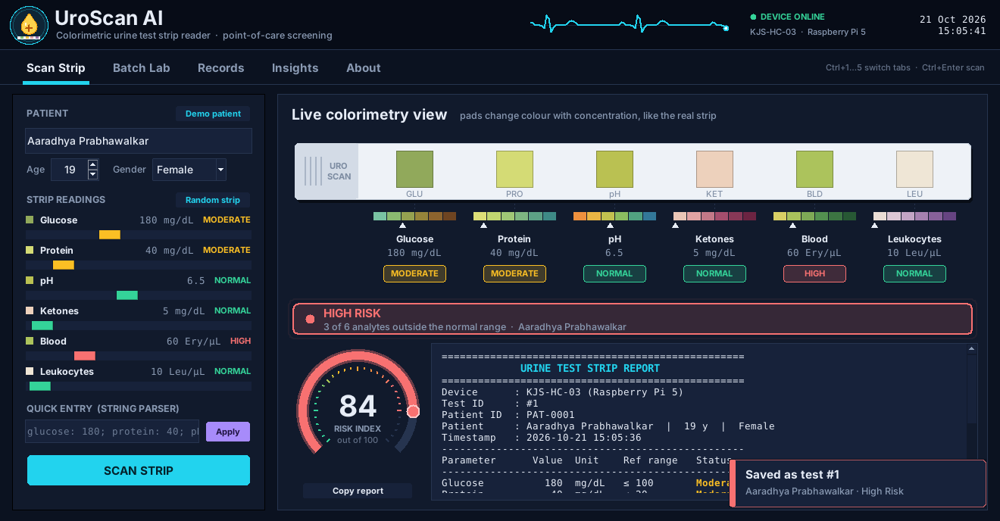
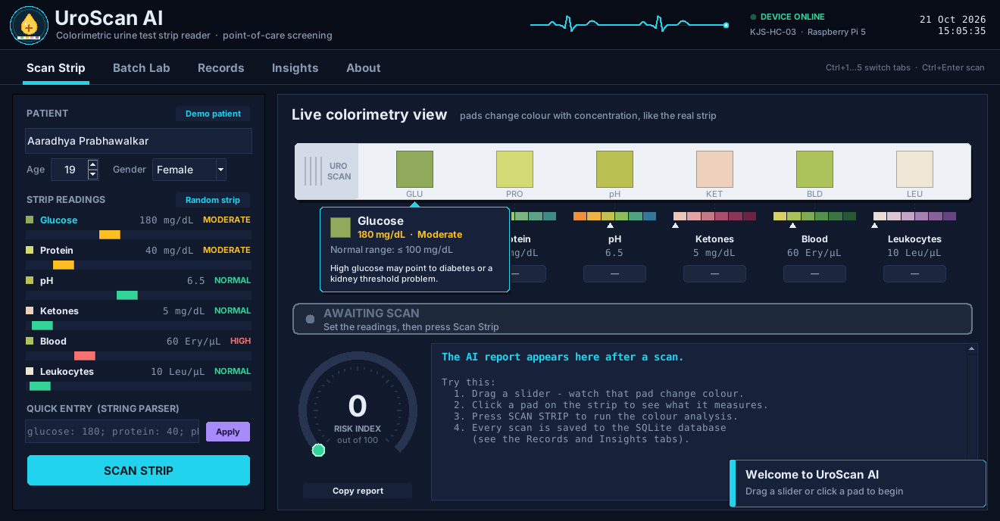
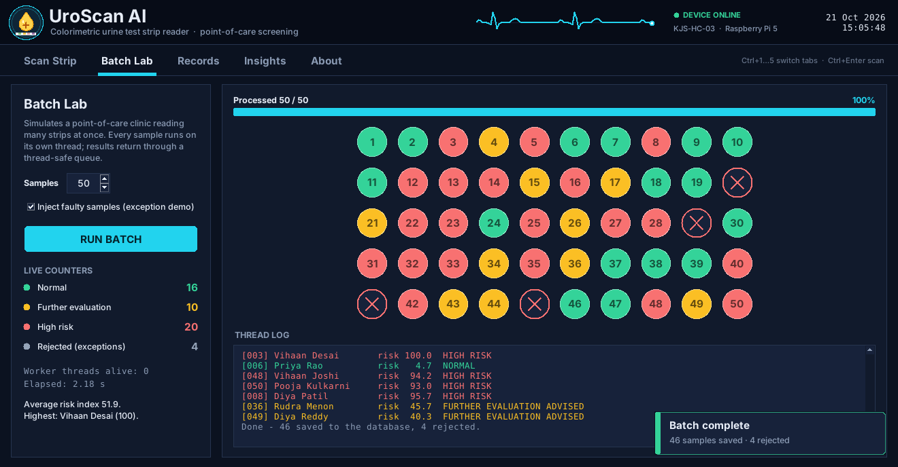
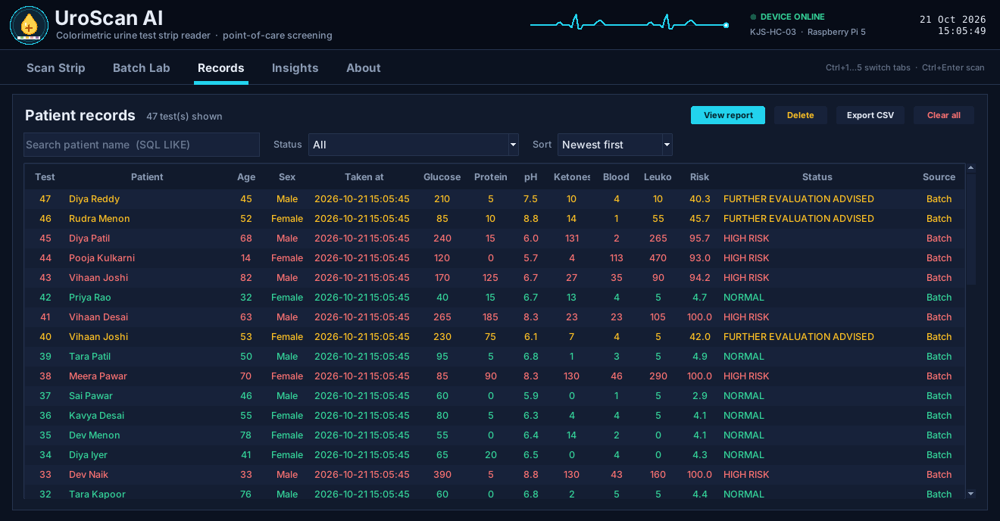
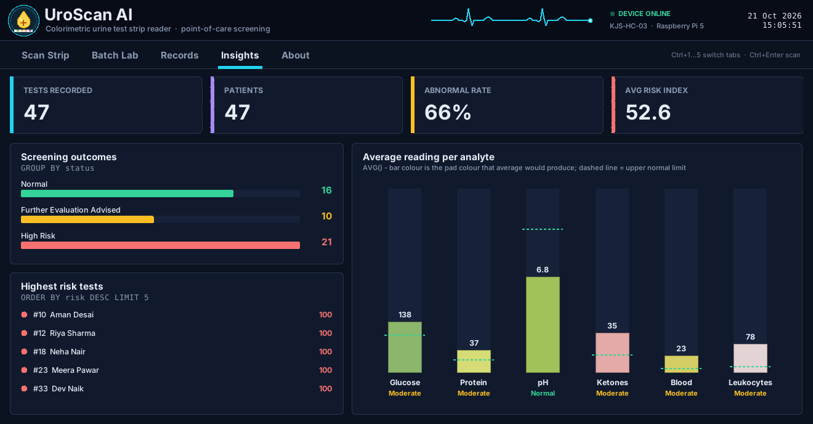
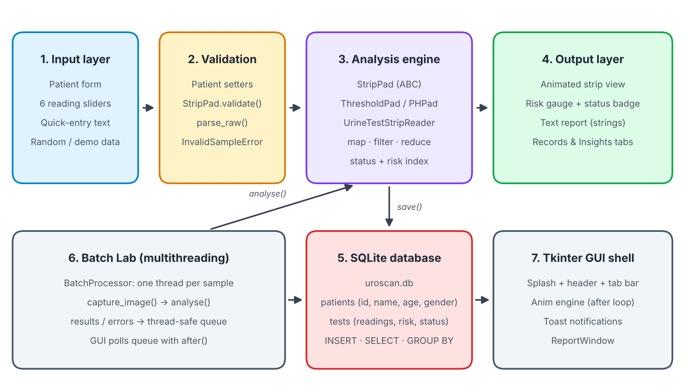

# UroScan AI — Colorimetric Urine Test Strip Reader

An interactive, animated desktop app built in Python with Tkinter. It simulates an AI-assisted **urine test strip reader**: you enter the readings of six reagent pads, the app shows the colour each pad would turn, classifies every reading, gives an overall screening status with a 0–100 risk index, and saves every test in an SQLite database.

Mini project for **Object Oriented Programming with Python (316U04L301)**, Department of Information Technology, K. J. Somaiya School of Engineering, 2026-27.
Case study **KJS-HLC-01**: Urine Test Strip Reader using Colorimetry as a Point-of-Care Technology.



## Features

- **Live colorimetry view.** Drag a slider and that pad on the drawn test strip changes colour, next to a reference colour chart. Click a pad to see its normal range and what it may indicate.
- **AI analysis.** Each of the six pads (glucose, protein, pH, ketones, blood, leukocytes) is classified as Normal, Moderate or High. The app then gives an overall status (Normal / Further evaluation advised / High risk) and a risk index.
- **Animated scan.** A glowing scan line sweeps the strip, each pad's result pops up, the risk gauge sweeps up and the report types itself out.
- **Quick entry.** Type readings such as `glucose: 180; protein: 40; pH 6.5` and the sliders glide to the new values.
- **Batch Lab.** Screens up to 100 samples at once, one thread per sample, with a live dot grid, counters and a thread log. You can inject faulty samples to see the error handling at work.
- **Records.** Every test is stored in SQLite. You can search by name, filter by status, sort, open a saved report, delete records and export them to CSV.
- **Insights.** Summary cards and animated charts built from the stored results.

## How to run

You only need Python 3.8 or later. The app uses nothing outside the standard library.

```bash
python uroscan_ai.py
```

On Windows you can use `py uroscan_ai.py` if `python` isn't found. The database file `uroscan.db` is created next to the script the first time you run it.

**Shortcuts:** `Ctrl+1` to `Ctrl+5` switch tabs, and `Ctrl+Enter` scans the strip.

## Screenshots

| Live colorimetry view | Batch Lab |
|---|---|
|  |  |
| **Records** | **Insights** |
|  |  |

## Architecture



## OOP concepts used (Experiments 1–8)

| Exp | Concept | Where it is used |
|---|---|---|
| 1 | Classes & objects | `Patient` with getter/setter methods, `@staticmethod`, `@classmethod` |
| 2 | Constructors & lists | Parameterised `__init__` in every class; lists of pads, results and threads |
| 3 | Strings & inheritance | `DiagnosticDevice` → `UrineTestStripReader`, the quick-entry parser and the formatted report |
| 4 | Abstract classes & polymorphism | `StripPad(ABC)` with `ThresholdPad` and `PHPad` overriding `classify()` |
| 5 | Exceptions & multithreading | `InvalidSampleError`, `try/except/finally`, `BatchProcessor` with a thread-safe queue |
| 6 | Collections & functional programming | dict / list / tuple / set with `map()`, `filter()`, `reduce()`, `lambda` |
| 7 | Tkinter Canvas | Logo, test strip, gauge, charts and every animation |
| 8 | SQLite | `patients` and `tests` tables with INSERT, SELECT, LIKE, JOIN, GROUP BY, AVG, DELETE |

## Classification rules

| Analyte | Unit | Normal | Moderate | High |
|---|---|---|---|---|
| Glucose | mg/dL | ≤ 100 | 101–250 | > 250 |
| Protein | mg/dL | ≤ 20 | 21–100 | > 100 |
| pH | – | 5.0–8.0 | 4.5–4.9 or 8.1–8.5 | > 8.5 |
| Ketones | mg/dL | ≤ 15 | 16–40 | > 40 |
| Blood | Ery/µL | ≤ 5 | 6–50 | > 50 |
| Leukocytes | Leu/µL | ≤ 15 | 16–125 | > 125 |

**Overall status:** 0 abnormal pads → Normal. 1–2 abnormal pads → Further evaluation advised. 3 or more abnormal pads, or 2 or more High pads → High risk.

## Team

All five members had an equal share (20% each) in the project.

| Member | Module |
|---|---|
| Aaradhya Prabhawalkar | Object model & analysis engine |
| Rudra | Database & Records |
| Vihaan | Exceptions, threads & Batch Lab |
| Dev | GUI design & Canvas graphics |
| Atharva | Inheritance, strings & animation |

## Disclaimer

This is an academic project. The readings are simulated, and the thresholds are simplified from typical dipstick charts. It is a screening demonstration, **not** a medical device and not a diagnosis.
